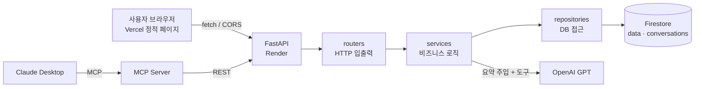
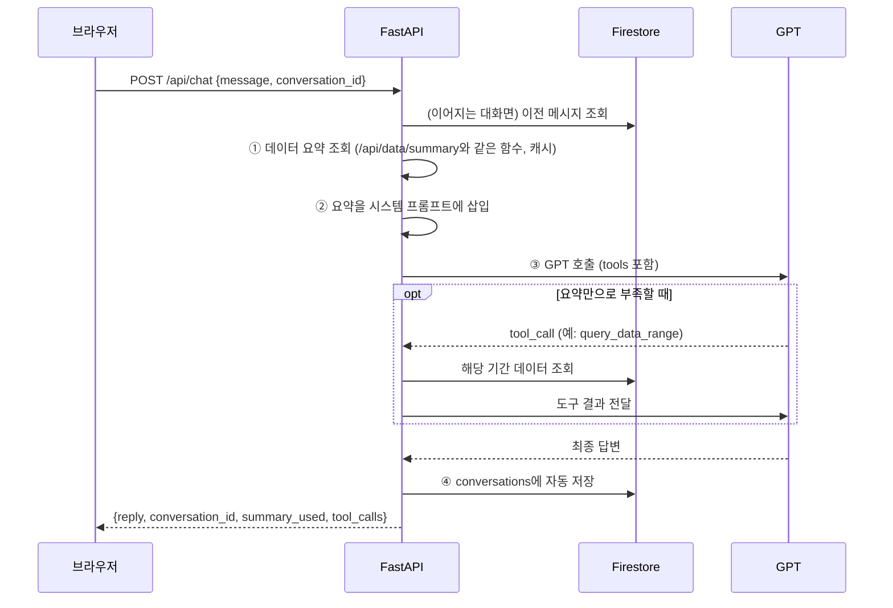

# 🌤️ 서울 날씨 AI 비서 — 내 데이터를 아는 AI
https://ai-m12-frontend.vercel.app/


## 서비스 소개

일반 챗봇에게 "이번 달 기온 어때?"라고 물으면 일반론만 돌아옵니다. 내가 가진 데이터를 모르기 때문입니다.

**서울 날씨 AI 비서**는 서울의 최근 1년 일평균 기온(365개 데이터)을 분석해 **요약 정보를 GPT의 시스템 프롬프트에 주입**합니다. 그래서 AI가 내 데이터를 근거로 답합니다. 데이터를 추가·수정·삭제하면 요약과 AI의 답변이 바로 바뀌고, 모든 대화는 자동으로 저장되어 나중에 다시 불러올 수 있습니다.

| 기능 | 설명 |
|---|---|
| 💬 데이터 기반 AI 채팅 | 요약 주입(컨텍스트 주입) + 필요 시 GPT가 직접 데이터 조회 도구 호출 · 로딩 표시 |
| 🗂 데이터 관리 (CRUD) | `(date, value, memo)` 추가 · 목록 · 수정 · 삭제, 같은 날짜 중복 방지 |
| 🕘 대화 기록 | 자동 저장 · 목록 · 불러오기 · 삭제 |
| 📊 요약 · 시각화 | 기간/개수/평균/최고/최저/최근 추세, 일별 그래프 + 7일 이동평균, 월별 표 |
| ⬇ 내보내기 · 🌙 다크 모드 | CSV/JSON 다운로드, 다크 모드 토글 |

## 배포 URL

| 구분 | 주소 |
|---|---|
| 프론트엔드 (Vercel) | https://`<프로젝트>`.vercel.app |
| 백엔드 API (Render) | https://`<서비스이름>`.onrender.com |
| Swagger UI | https://`<서비스이름>`.onrender.com/docs |

> ⏱ 백엔드는 Render 무료 티어라 15분 동안 요청이 없으면 잠듭니다. 첫 접속 시 깨어나는 데 **최대 1분** 걸릴 수 있으며, 화면에 안내 배너가 표시됩니다.

## 기술 스택

| 영역 | 기술 |
|---|---|
| Backend | Python 3.12, **FastAPI**, Uvicorn, **Pydantic v2** |
| Database | **Firebase Firestore** (firebase-admin) |
| AI | **OpenAI Chat Completions API** + Function Calling |
| Frontend | **HTML / CSS / JavaScript** (프레임워크 없음, Canvas로 그래프 직접 구현) |
| 배포 | Render (백엔드), Vercel (프론트엔드) |
| 데이터 | Open-Meteo Historical Weather API (ERA5, CC BY 4.0) |
| 보너스 | MCP Server (Claude Desktop 연동) |

## 아키텍처



### 채팅 동작 흐름 (`POST /api/chat`)



## 프로젝트 구조

```
ai-weather-assistant/
├── backend/
│   ├── main.py                    # 앱 생성, CORS, 예외 처리, 라우터 등록
│   ├── app/
│   │   ├── config.py              # 환경 변수 로드 (키는 코드에 없음)
│   │   ├── schemas.py             # Pydantic 요청/응답 모델 (입력 검증)
│   │   ├── errors.py              # 서비스 예외 → HTTP 상태 코드
│   │   ├── routers/               # data.py · conversations.py · chat.py
│   │   ├── services/              # data · summary · conversation · chat · tools
│   │   └── repositories/          # firestore.py (운영) · memory.py (로컬 테스트)
│   ├── scripts/seed_data.py       # 서울 최근 365일 기온 → Firestore
│   ├── tests/test_services.py     # 서비스 테스트 (Firebase·OpenAI 없이 실행)
│   ├── requirements.txt
│   └── .env.example
├── frontend/
│   ├── index.html · style.css · app.js
│   ├── config.js                  # 로컬용 API 주소
│   ├── build.js                   # Vercel 빌드: 환경 변수 → dist/config.js
│   └── vercel.json
├── mcp_server/                    # (보너스) MCP 서버 + Claude Desktop 설정 예시
├── docs/
│   ├── SETUP_GUIDE.md             # 설정·배포 단계별 가이드
│   └── screenshots/
└── render.yaml                    # (선택) Render Blueprint
```

## 로컬 실행 방법

> Firebase·OpenAI 계정 만들기부터 배포까지 전체 과정은 **[docs/SETUP_GUIDE.md](docs/SETUP_GUIDE.md)**에 순서대로 정리했습니다.

```bash
# 1) 백엔드
cd backend
python -m venv .venv
.venv\Scripts\python.exe -m pip install -r requirements.txt   # macOS/Linux: .venv/bin/python
copy .env.example .env                                         # 값 채우기
.venv\Scripts\python.exe scripts\seed_data.py                  # 초기 데이터 365개 적재
.venv\Scripts\python.exe -m uvicorn main:app --reload          # http://localhost:8000/docs

# 2) 프론트엔드 (새 터미널)
cd frontend
python -m http.server 5500                                     # http://localhost:5500
```

## 환경 변수

**백엔드 (Render / `backend/.env`)**

| 변수 | 필수 | 설명 | 예시 |
|---|---|---|---|
| `OPENAI_API_KEY` | ✅ | OpenAI API 키 | `sk-...` |
| `FIREBASE_SERVICE_ACCOUNT_JSON` | ✅* | 서비스 계정 키 JSON 내용 전체 (배포용) | `{"type":"service_account",...}` |
| `FIREBASE_SERVICE_ACCOUNT_PATH` | ✅* | 서비스 계정 키 파일 경로 (로컬용) | `./serviceAccountKey.json` |
| `ALLOWED_ORIGINS` | ✅ | CORS 허용 주소 (쉼표 구분) | `https://xxx.vercel.app,http://localhost:5500` |
| `OPENAI_MODEL` | | 사용할 모델 | `gpt-5.4-mini` (기본) |
| `OPENAI_MAX_TOKENS` | | 응답 최대 토큰 (비용 제한) | `1500` |
| `ENABLE_TOOLS` | | Function Calling 사용 | `true` |
| `ALLOWED_ORIGIN_REGEX` | | 미리보기 주소 허용용 정규식 | `https://.*\.vercel\.app` |
| `USE_MEMORY_DB` | | Firebase 없이 로컬 테스트 | `false` |
| `PYTHON_VERSION` | | Render Python 버전 | `3.12.7` |

\* `FIREBASE_SERVICE_ACCOUNT_JSON`과 `FIREBASE_SERVICE_ACCOUNT_PATH` 중 하나는 반드시 설정해야 합니다.

**프론트엔드 (Vercel)**

| 변수 | 필수 | 설명 |
|---|---|---|
| `API_BASE_URL` | ✅ | 백엔드 주소. 빌드 시 `config.js`로 주입 |

## API 명세

전체 명세와 요청 예시는 Swagger UI(`/docs`)에서 확인하고 직접 실행해 볼 수 있습니다.

| 메서드 | 경로 | 설명 |
|---|---|---|
| POST | `/api/data` | 새 데이터 추가 (같은 날짜면 409) |
| GET | `/api/data` | 목록 조회 (`start`, `end`, `order`, `limit`) |
| PUT | `/api/data/{id}` | 수정 (바꿀 필드만 전송) |
| DELETE | `/api/data/{id}` | 삭제 |
| GET | `/api/data/summary` | **요약 (프롬프트 주입용)** |
| GET | `/api/data/statistics` | (보너스) 이동평균·변동성·요일별·월별 통계 |
| POST | `/api/conversations` | 대화 저장 |
| GET | `/api/conversations` | 대화 목록 (**messages 미포함**) |
| GET | `/api/conversations/{id}` | 특정 대화 전체 messages (**불러오기: 방식 A**) |
| DELETE | `/api/conversations/{id}` | 대화 삭제 |
| POST | `/api/chat` | AI 대화 (요약 주입 → GPT → 자동 저장) |
| GET | `/api/chat/system-prompt` | 현재 주입되는 시스템 프롬프트 확인 |
| GET | `/health` | 상태 확인 (콜드스타트 깨우기용) |

### Firestore 컬렉션 구조

```
data/{autoId}
  date: "2026-11-01"        # YYYY-MM-DD (중복 불가)
  value: 9.8                # 일평균 기온 ℃
  memo: "최고 14.2℃ / 최저 5.1℃ / 강수 2.3mm"
  created_at, updated_at    # ISO 8601

conversations/{autoId}
  title: "최근 일주일 기온 추세가 어때?"   # 첫 질문으로 자동 생성
  messages: [ {role, content, timestamp, tool_calls[]} , ... ]
  message_count: 4
  last_message: "..."         # 목록 표시용
  created_at, updated_at
```

목록 조회 시 Firestore `select()`로 `messages` 필드를 빼고 읽어 전송량을 줄입니다.

## 핵심 설계 설명

### 1. 시계열 분석 → 요약 → 서비스 활용

`summary_service.py`는 DB·HTTP와 무관한 순수 함수로 요약을 만듭니다.

- **기본 통계:** 기간, 개수, 평균, 중앙값, 최고(날짜), 최저(날짜), 표준편차, 최근 값
- **최근 추세:** 최근 7일 평균과 직전 7일 평균을 비교합니다. 변화가 전체 표준편차의 10%보다 작으면 "유지", 크면 "상승" 또는 "하락"으로 판단합니다. 단위가 다른 데이터에도 같은 규칙을 쓸 수 있습니다.
- **월별 통계:** 최근 12개월의 평균·최고·최저

같은 요약 결과가 **① 프론트 요약 카드**와 **② 채팅 시스템 프롬프트** 두 곳에서 쓰입니다. 데이터가 바뀌면 캐시를 즉시 비워 다음 요청부터 새 요약이 반영됩니다. 시드 스크립트처럼 서버 밖에서 바뀐 경우를 대비해 2분 TTL도 둡니다.

**요약 API 응답 예시** (`GET /api/data/summary`)
```json
{
  "title": "서울 일평균 기온", "unit": "℃",
  "period": "2025-11-15 ~ 2026-11-14", "count": 365,
  "metrics": { "average": 13.1, "median": 13.9,
               "max": {"value": 30.4, "date": "2026-08-04"},
               "min": {"value": -11.2, "date": "2026-01-23"},
               "std": 9.8, "total": 4781.5, "latest": {"value": 8.4, "date": "2026-11-14"} },
  "trend": "하락 (최근 7일 평균 7.9℃, 직전 7일 대비 -2.6℃)",
  "monthly": [ {"month": "2026-10", "average": 15.2, "max": 20.1, "min": 9.3, "count": 31} ]
}
```
*(형식 예시입니다. 실제 값은 시드 시점의 데이터에 따라 다릅니다.)*

### 2. 컨텍스트 주입 (Context Injection)

GPT는 학습 이후의 내 데이터를 모릅니다. 그래서 요청마다 **요약을 텍스트로 만들어 시스템 프롬프트 맨 앞에 넣습니다.** GPT는 이 내용을 "이미 알고 있는 사실"처럼 받아들여 근거로 답합니다.

전체 데이터(365행) 대신 요약만 넣는 이유는 세 가지입니다.
- **토큰 비용:** 매 요청에 365행을 넣으면 비용이 커집니다.
- **정확도:** 평균·최고처럼 계산이 필요한 값을 GPT에 맡기지 않고 서버가 미리 정확히 계산합니다.
- **세부 데이터:** 특정 날짜 같은 세부 내용은 아래 도구 호출로 필요할 때만 가져옵니다.

실제 주입되는 프롬프트는 `GET /api/chat/system-prompt`로 확인할 수 있습니다.

```
당신은 사용자의 데이터를 이해하고 답하는 '데이터 분석 비서'입니다.
[사용자 데이터 요약]
- 데이터 기간: {period}
- 총 레코드: {count}개
- 주요 지표: 평균 …, 최고 …(날짜), 최저 …(날짜) …
- 최근 트렌드: {trend}
- 월별 평균: …
[답변 규칙] 수치에는 단위와 날짜를 밝히고, 데이터로 알 수 없는 것은 추측하지 않는다 …
```

### 3. 라우터 / 서비스 / 저장소 분리 기준

| 계층 | 책임 | 알지 않는 것 |
|---|---|---|
| `routers/` | URL, 쿼리·경로 파라미터, 상태 코드, 응답 모델 | DB 종류, GPT 호출 방식 |
| `services/` | 중복 검사, 요약 계산, 캐시, 프롬프트 구성, 도구 실행, 자동 저장 | HTTP, Firestore API 세부 |
| `repositories/` | Firestore 읽기·쓰기 | 비즈니스 규칙 |

**이렇게 나눠서 얻는 점**
- 서비스 코드를 FastAPI 없이 테스트할 수 있습니다 (`tests/test_services.py`: 메모리 DB + 가짜 GPT).
- 같은 요약 함수를 API 응답, 프롬프트 주입, AI 도구, MCP 서버가 함께 씁니다.
- 서비스는 HTTP를 모르기 때문에 `NotFoundError` 같은 자체 예외를 던지고, `main.py`가 이를 404/409/503 같은 HTTP 상태 코드로 바꿉니다.

### 4. Pydantic 입력 검증

잘못된 입력이 DB와 GPT 프롬프트에 들어가기 전에 막습니다. 검증에 실패하면 FastAPI가 자동으로 **422**와 함께 어떤 필드가 왜 틀렸는지 돌려주고, 프론트는 이 메시지를 그대로 보여 줍니다.

| 스키마 | 규칙 |
|---|---|
| `DataCreate` | 날짜 형식(YYYY-MM-DD)과 범위, `value`는 유한한 숫자(NaN/Infinity 거부), `memo` 최대 200자, 앞뒤 공백 제거 |
| `DataUpdate` | 모든 필드 선택이지만 **최소 1개는 필수** |
| `ChatRequest` | 질문 1~1000자 (빈 문자열·공백만 있는 입력 거부) → 프롬프트 남용·비용 폭주 방지 |
| `ConversationCreate` | `role`은 `user`/`assistant`만 허용, 메시지 1~200개 |

응답에도 `response_model`을 지정해 Swagger에 정확한 스키마가 표시되고, 정의되지 않은 필드는 응답에서 빠집니다.

### 5. 배포 환경의 CORS · 환경 변수 · 키 관리

- **CORS:** 프론트(`vercel.app`)와 API(`onrender.com`)는 출처가 달라 브라우저가 기본적으로 요청을 막습니다. `ALLOWED_ORIGINS`에 등록한 내 프론트 주소만 허용합니다. `*`로 전체를 허용하면 다른 사이트가 내 API로 OpenAI 크레딧을 쓸 수 있습니다.
- **환경 변수:** 로컬·운영 환경의 차이(DB 키, 허용 주소, API 주소)를 코드 수정 없이 설정만으로 바꿉니다.
- **키 관리:** OpenAI 키와 Firebase 키는 서버 환경 변수에만 있고 브라우저로 전달되지 않습니다. `.env`와 키 파일은 `.gitignore`로 커밋을 막았습니다. 프론트의 `API_BASE_URL`은 공개되어도 되는 값이라 빌드 시 주입합니다.

### 6. 오류 처리

| 상황 | 응답 | 화면 |
|---|---|---|
| 입력값 오류 | 422 + 필드별 사유 | "입력값 오류: value …" 알림 |
| 없는 ID | 404 | 알림 |
| 같은 날짜 중복 | 409 | "이미 있습니다. 수정을 사용하세요" |
| Firebase/OpenAI 키 누락·오류, 모델 없음 | 503 + 어떤 환경 변수를 확인할지 안내 | 채팅 말풍선에 안내 |
| OpenAI 한도 초과 | 429 | 안내 |
| OpenAI 연결·시간 초과 | 502 | 안내 |
| 대화 저장만 실패 | 답변은 반환, `saved: false` | "저장 실패" 알림 |
| 서버가 잠듦 (콜드스타트) | — | 배너 + 최대 3회 재시도 |

## 보너스 1 — Function Calling + MCP

### 도구 정의와 호출 근거

시스템 프롬프트에는 요약만 들어 있으므로, 요약으로 답할 수 없는 질문에서 GPT가 스스로 도구를 고릅니다. 도구 설명(`description`)이 곧 GPT의 판단 기준입니다. 정의는 `backend/app/services/tools.py`에 있습니다.

| 도구 | 호출하는 경우 (근거) | 질문 예 |
|---|---|---|
| `query_data_range(start_date, end_date)` | 요약에 없는 **특정 기간**의 일별 값이 필요할 때 | "10월 첫째 주 기온 알려줘" |
| `find_extreme_days(kind, n)` | 요약에는 최고·최저 1개만 있어 **순위**가 필요할 때 | "가장 추웠던 날 TOP 3" |
| `get_statistics()` | **변동성·요일별·전체 월별** 통계가 필요할 때 | "기온 변화가 가장 심했던 날은?" |
| `get_data_summary()` | 대화 중 데이터가 바뀌어 **최신 요약**을 다시 확인할 때 | "방금 추가한 거 반영됐어?" |
| `list_recent_conversations(limit)` | **예전 대화**를 물을 때 | "지난번에 뭐 물어봤었지?" |

호출된 도구는 응답의 `tool_calls`와 저장된 메시지에 기록되고, 채팅 화면에 `🔧 find_extreme_days(max ~ 3)` 같은 칩으로 표시됩니다. 그래서 **어떤 근거로 어떤 도구를 호출했는지** 확인할 수 있습니다.

### 호출 흐름

1. 사용자 질문 + 요약이 주입된 시스템 프롬프트 + 도구 스키마 5개를 GPT에 전달합니다.
2. GPT가 요약만으로 답할 수 없다고 판단하면 `tool_calls`를 돌려줍니다.
3. 서버가 해당 서비스 함수를 실행하고, 결과(JSON)를 `role: tool` 메시지로 다시 전달합니다.
4. 1~3을 최대 4회 반복합니다. 마지막 회차에는 도구 없이 호출해 반드시 답변이 나오게 합니다.
5. 최종 답변과 도구 호출 기록을 저장합니다.

### MCP 서버로 외부 채널 검증

`mcp_server/server.py`는 같은 기능을 **MCP 도구**로 노출합니다. 이 서버는 배포된 REST API를 호출하므로 웹 서비스와 같은 데이터를 봅니다.

| MCP 도구 | 호출하는 API |
|---|---|
| `get_data_summary` | `GET /api/data/summary` |
| `query_data_range` | `GET /api/data?start=&end=` |
| `get_statistics` | `GET /api/data/statistics` |
| `list_conversations` | `GET /api/conversations` |
| `ask_assistant` | `POST /api/chat` (웹 비서에게 질문, 대화 자동 저장) |

Claude Desktop 연동 방법은 [SETUP_GUIDE 8단계](docs/SETUP_GUIDE.md#8-보너스-mcp-연동-확인--claude-desktop)를 참고하세요.

## 보너스 2 — 인사이트·UX 고도화

| 항목 | 구현 |
|---|---|
| 추가 지표 | `/api/data/statistics`: 7일 이동평균 시계열, 전일 대비 변화량 표준편차, 최대 상승/하락일, 요일별 평균, 전체 월별 통계. 요약에도 중앙값·표준편차·월별 통계 포함 |
| 시각화 | Canvas로 일별 값 + 7일 이동평균 그래프를 직접 그림. 기간(30일/90일/전체) 선택, 마우스를 올리면 툴팁 표시 |
| 내보내기 | CSV(엑셀 한글 깨짐 방지 BOM 포함) · JSON(요약 포함) 다운로드 |
| 다크 모드 | 토글 + 선택 기억(localStorage) + 시스템 설정 자동 감지 |

## 제출 스크린샷

| 데이터 요약이 보이는 채팅 화면 |
|---|
|  |

| 데이터 관리 (추가/수정) | 대화 기록 불러오기 |
|---|---|
|  |  |

| Swagger UI | 다크 모드 · 그래프 (보너스) |
|---|---|
|  |  |

## 비용 · 운영 주의

- OpenAI API는 사용량만큼 과금됩니다. 응답 토큰 상한(`OPENAI_MAX_TOKENS`), 이전 대화 10개 제한, 질문 1000자 제한, 도구 호출 4회 제한을 두었습니다. OpenAI 대시보드에서 월 예산 한도도 설정하세요.
- Firestore 무료 요금제의 일일 읽기 한도를 아끼기 위해, 요약·목록은 서버 메모리에 캐시하고 데이터가 바뀔 때만 다시 읽습니다.
- `USE_MEMORY_DB=true`는 로컬 테스트 전용입니다. 배포 환경에서는 Firestore를 사용합니다.

## 데이터 출처

Weather data by [Open-Meteo.com](https://open-meteo.com/) (CC BY 4.0), generated using Copernicus Climate Change Service information (ERA5). 서울시청 부근 격자의 일평균 기온이며, 관측소 값과는 차이가 있을 수 있습니다.
